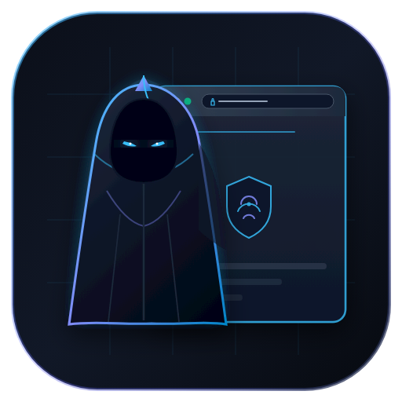

# CloakDesk

<p align="center">
  
</p>

<p align="center">
  <b>Manajer Profil Browser Anti-Detect Mandiri untuk Linux</b><br />
  Kompatibel penuh dengan SDK ixBrowser Local API v2, local-first, tanpa ketergantungan cloud pihak ketiga, dilengkapi sinkronisasi multi-perangkat terenkripsi end-to-end.
</p>

---

## Ringkasan Proyek

**CloakDesk** adalah platform manajemen profil browser anti-detect yang berjalan di atas engine Chromium terisolasi (*fingerprint-chromium* 150) pada sistem Linux. CloakDesk dirancang dengan prinsip **local-first**: seluruh eksekusi browser, manipulasi jendela, perutean proxy, serta data sesi berjalan langsung di komputer lokal pengguna demi menjaga keaslian sidik jari perangkat keras (GPU, layar, audio, WebGL, timezone).

CloakDesk menyediakan API lokal di `127.0.0.1:53200` yang mengimplementasikan kontrak **ixBrowser Local API v2**, sehingga skrip otomasi Selenium, Puppeteer, maupun pustaka resmi `ixbrowser-local-api` dapat langsung digunakan tanpa modifikasi kode.

Selain sebagai peluncur lokal, CloakDesk dilengkapi arsitektur **sinkronisasi multi-perangkat mandiri (self-hosted)**: server sinkronisasi dapat dipasang di VPS pribadi untuk menyinkronkan profil, grup, proxy, cookie sesi, bookmark, ekstensi, dan password tersimpan antar-komputer secara aman dengan enkripsi amplop sisi klien (*client-side envelope encryption*). Server tidak pernah menjalankan browser dan tidak memiliki akses ke data sensitif (*zero-knowledge*).

---

## Fitur Utama

- **Isolasi Fingerprint Nyata**: Engine *fingerprint-chromium* 150 mengisolasi Canvas, WebGL, AudioContext, font, ClientRects, platform OS, core CPU, memori, bahasa, dan timezone.
- **Penyaringan Seed Aman (Seed Screening)**: Menggunakan tabel 2.093 seed aman terverifikasi pada engine 150 untuk mencegah anomali lebar teks kanvas bernilai negatif.
- **Kompatibilitas SDK ixBrowser**: Meniru endpoint `/api/v2/<action>` ixBrowser v2 secara transparan, lengkap dengan format respons standar dan pagination.
- **Dukungan Proxy Lengkap dengan Autentikasi**: Mendukung proxy Direct, HTTP, HTTPS, dan SOCKS5. Proxy yang membutuhkan autentikasi username/password dijembatani otomatis via proses `gost` per profil.
- **Sinkronisasi Multi-Perangkat (Self-Hosted VPS)**:
  - **Server Mandiri**: Berjalan sebagai kontainer ringan atau binary Python di VPS dengan database SQLite WAL.
  - **Kunci Profil Terdistribusi (Distributed Profile Lease)**: Mencegah pembukaan profil yang sama secara bersamaan di dua komputer (TTL 60 detik, heartbeat otomatis 20 detik, dan fencing token monotonik).
  - **Enkripsi Klien Zero-Knowledge**: Cookie sesi dan password dienkripsi dengan AES-256-GCM berbasis kunci turunan frasa sandi pengguna (*passphrase*) sebelum diunggah ke server.
  - **Dukungan Buka Offline**: Profil tetap dapat dibuka dan diedit saat komputer offline (*Allow with Warning*), antrean perubahan tersimpan di outbox lokal dan otomatis dikirim saat kembali online.
- **Impor Penuh Arsip ixBrowser**:
  - Mengimpor file zip ekspor cookie (`<serial>_<judul>.txt`) dan metadata spreadsheet (`excel.xlsx`).
  - Pemetaan grup, penentuan platform otomatis dari domain cookie, dan pembacaan cookie Chromium v10.
  - Tersedia lewat antarmuka dialog GUI dan perintah CLI `scripts/import-ixbrowser.py`.
- **Penutupan Bersih (Graceful Shutdown)**: Seluruh tab halaman ditutup melalui DevTools Protocol (`/json/close/<id>`) sebelum proses dimatikan, menjamin seluruh cookie SQLite ter-flush sempurna ke disk.
- **Pembersihan Otomatis Proses Mati**: Jika jendela browser ditutup langsung dari tombol silang desktop (X11), status profil di memori dan kunci lease langsung dibersihkan otomatis.
- **Antarmuka Desktop Modern**: Dashboard berbasis Vue 3 + Element Plus di port `5180` dengan tema bersih, indikator status sinkronisasi topbar, badge lease perangkat lain, dialog manajemen profil 5 tab, keranjang sampah, dan log aktivitas lokal.

---

## Memulai Cepat (Penggunaan Lokal)

### 1. Menjalankan Server API Lokal

```bash
# Masuk ke direktori proyek dan aktifkan virtualenv
cd /home/zdna/Projects/antidetect
./venv/bin/python -m antidetect serve
```

API lokal akan aktif di `http://127.0.0.1:53200` dan siap menerima permintaan.

### 2. Menjalankan Antarmuka Pengguna (Web UI)

```bash
cd ui
npm run dev
```

Buka peramban di `http://127.0.0.1:5180`. Antarmuka Vue akan terhubung langsung ke API lokal di port 53200.

Untuk kompilasi produksi mandiri:
```bash
cd ui
npm run build
```

### 3. Penggunaan Perintah CLI

CloakDesk menyediakan antarmuka CLI terpadu:

```bash
# Menampilkan bantuan perintah
python3 -m antidetect --help

# Membuat profil baru
python3 -m antidetect create "Toko Utama" --platform Windows --tz Asia/Jakarta --lang id-ID

# Membuka dan menutup profil
python3 -m antidetect open 1
python3 -m antidetect close 1

# Menampilkan daftar profil
python3 -m antidetect list
```

---

## Panduan Sinkronisasi Multi-Perangkat (Self-Hosted)

Sistem sinkronisasi CloakDesk memisahkan fungsi server murni sebagai penyimpan metadata dan blob terenkripsi, sementara browser selalu berjalan di komputer lokal pengguna.

```text
+-----------------------+              +-----------------------+
|   Laptop Utama (A)    |              |    Laptop Kedua (B)   |
|  - Engine Lokal       |              |  - Engine Lokal       |
|  - SQLite antidetect  |              |  - SQLite antidetect  |
+-----------+-----------+              +-----------+-----------+
            |                                      |
            | Push / Pull                          | Push / Pull
            | Kunci Lease (Heartbeat)              | Kunci Lease
            | AES-256-GCM Blobs                    | AES-256-GCM Blobs
            v                                      v
  +----------------------------------------------------------+
  |             SERVER SINKRONISASI (VPS Pribadi)            |
  |  - Endpoint /v1/sync/* (HTTPS / Reverse Proxy)           |
  |  - Database server_sync.db (SQLite WAL + change_log)     |
  |  - Penyimpanan Berkas Blob Terenkripsi                   |
  +----------------------------------------------------------+
```

### 1. Menjalankan Server Sinkronisasi di VPS

Di server VPS (Linux), pasang dependensi dan jalankan server sinkronisasi:

```bash
# Menjalankan langsung via Python
python3 -m antidetect sync-server run --host 0.0.0.0 --port 53210 --data-dir /var/lib/cloakdesk-sync

# Atau menggunakan Docker
docker build -f Dockerfile.sync-server -t cloakdesk-sync .
docker run -d --name cloakdesk-sync -p 53210:53210 -v /var/lib/cloakdesk-sync:/data cloakdesk-sync
```

Buat token pendaftaran satu kali untuk menghubungkan komputer pertama:
```bash
python3 -m antidetect sync-server token create --label "Laptop Utama" --ttl 120
# Output: ad_enroll_xxxxxxxxxxxxxxxxxxxxxxxx
```

### 2. Menghubungkan Komputer Lokal

1. Buka antarmuka CloakDesk di browser (`http://127.0.0.1:5180/#/settings`).
2. Masuk ke kartu **Sinkronisasi Antar Perangkat**.
3. Masukkan:
   - **URL Server**: Alamat server VPS kamu (misalnya `https://sync.domainanda.com` atau `http://IP_VPS:53210`).
   - **Token Pendaftaran**: Token yang dihasilkan dari langkah sebelumnya.
   - **Nama Perangkat**: Nama komputer ini (misalnya `Laptop Kerja`).
   - **Frasa Sandi Enkripsi (Passphrase)**: Buat kata sandi rahasia untuk mengunci data sesi.
4. Klik **Hubungkan Server**.

Indikator status pada bagian kanan topbar akan otomatis berubah menjadi hijau (**Sync: Aktif**), dan seluruh profil lokal akan disinkronkan secara aman ke server.

---

## Pemetaan Fingerprint ke Flag Engine

| Konfigurasi Fingerprint | Flag Engine Chromium | Keterangan & Efek |
| --- | --- | --- |
| `platform` (`Windows` / `Macos`) | `--fingerprint-platform=windows/macos` | Menyesuaikan User-Agent, `navigator.platform`, dan Client Hints. |
| `system_version` (`10` / `11`) | `--fingerprint-platform-version=<versi>` | Mengatur `platformVersion` pada Client Hints User-Agent. |
| `hardware_concurrency` | `--fingerprint-hardware-concurrency=N` | Nilai `navigator.hardwareConcurrency` (jumlah core CPU). |
| `device_memory` | `--fingerprint-memory=N` | Nilai `navigator.deviceMemory` (RAM dalam GB). |
| `language` | `--lang`, `--accept-lang` | Nilai `navigator.language` dan header HTTP `Accept-Language`. |
| `timezone` | `--timezone=<zona>` | Zona waktu JavaScript (contoh: `Asia/Jakarta`). |
| `seed` | `--fingerprint=<seed>` | Nilai acak konsisten yang mendasari isolasi Canvas, WebGL, dan GPU vendor/renderer. |
| `disable_spoofing` | `--disable-spoofing=<komponen>` | Mematikan penyamaran pada komponen terpilih (`canvas`, `gpu`, dll.) agar menggunakan perangkat asli. |

---

## Proxy dengan Autentikasi Gost

Chromium bawaan tidak mendukung autentikasi proxy HTTP/SOCKS5 secara langsung lewat flag baris perintah. CloakDesk secara otomatis mengelola proses jembatan lokal `gost` untuk setiap profil yang memiliki username dan password proxy:

```text
[Engine Chrome] --> [Listener Lokal gost: 127.0.0.1:<port>] --> [Proxy Hulu Otentikasi] --> [Internet]
```

Skrip pemasangan gost otomatis tersedia di:
```bash
scripts/fetch-gost.sh
```

---

## Impor Data ixBrowser

CloakDesk dapat membaca dan memigrasikan seluruh profil dari file ekspor ixBrowser:

```bash
# Pratinjau isi arsip ekspor
./venv/bin/python scripts/import-ixbrowser.py --zip "Export Profiles Cookies.zip"

# Menjalankan impor langsung ke database
./venv/bin/python scripts/import-ixbrowser.py --zip "Export Profiles Cookies.zip" --apply
```

Pada antarmuka GUI, tombol **Impor ixBrowser** di toolbar daftar profil menyediakan pemilih berkas untuk mengunggah ZIP cookie wajib dan ZIP metadata `Export Profile.zip` opsional, lengkap dengan pratinjau deteksi duplikat dan konfirmasi pembaruan.

---

## Pengujian Mandiri Otomatis

CloakDesk dilengkapi rangkaian skrip pengujian komprehensif tanpa perlu membuka browser secara manual:

```bash
# Pengujian kontrak SDK resmi ixBrowser
./venv/bin/python scripts/selftest.py

# Pengujian isolasi cookie dan penutupan bersih
DISPLAY=:0 ./venv/bin/python scripts/isolation_test.py

# Pengujian jembatan autentikasi proxy gost lokal
./venv/bin/python scripts/test-auth-proxy.py

# Pengujian impor arsip ixBrowser (19 skenario verifikasi)
./venv/bin/python scripts/test-ixbrowser-import.py

# Pengujian sinkronisasi multi-perangkat (Fase 1 sampai Fase 5)
./venv/bin/python scripts/test-sync.py
```

---

## Struktur Berkas Proyek

```text
/home/zdna/Projects/antidetect/
├── assets/                          # Asset visual (logo CloakDesk SVG dan PNG)
├── antidetect/                      # Paket utama Python
│   ├── __main__.py                  # Titik masuk perintah CLI
│   ├── api.py                       # HTTP server Local API v2 (:53200)
│   ├── bookmarks.py                 # Ekstraksi dan injeksi Default/Bookmarks
│   ├── cookies.py                   # Dekripsi dan enkripsi SQLite Cookies v10
│   ├── extensions.py                # Manajemen paket ekstensi lokal
│   ├── iximport.py                  # Modul pengurai arsip ekspor ixBrowser
│   ├── launcher.py                  # Orkestrasi proses Chromium, wrapper, dan gost
│   ├── passwords.py                 # Dekripsi dan injeksi SQLite Login Data
│   ├── store.py                     # Lapisan database lokal SQLite & sync outbox
│   ├── sync_agent.py                # Agen sinkronisasi klien & thread heartbeat lease
│   ├── sync_crypto.py               # Enkripsi amplop AES-256-GCM & penurunan kunci
│   └── sync_server.py               # Server sinkronisasi mandiri (:53210)
├── docs/                            # Dokumentasi teknis dan rencana arsitektur
│   └── SYNC-PLAN.md                 # Spesifikasi lengkap sinkronisasi terdistribusi
├── scripts/                         # Skrip utilitas, pengujian, dan layanan
│   ├── fetch-gost.sh                # Pemasang binary gost
│   ├── test-sync.py                 # Pengujian otomatis seluruh alur sinkronisasi
│   ├── test-ixbrowser-import.py     # Pengujian impor ekspor ixBrowser
│   ├── selftest.py                  # Verifikasi integrasi SDK ixBrowser
│   └── antidetect-sync-server.service # Berkas unit systemd untuk VPS
├── ui/                              # Frontend Vue 3 + Element Plus
│   ├── src/views/Profiles.vue       # Tabel profil, badge lease, aksi buka/tutup
│   ├── src/views/Settings.vue       # Halaman pengaturan & kartu sync server
│   └── src/App.vue                  # Shell aplikasi & indikator sync topbar
├── Dockerfile.sync-server           # Kontainer Docker server sinkronisasi
└── README.md                        # Dokumentasi proyek
```

---

## Lisensi

Proyek ini dilisensikan di bawah **GNU Affero General Public License v3.0** (`AGPL-3.0-only`). Lihat berkas `LICENSE` untuk informasi selengkapnya.
